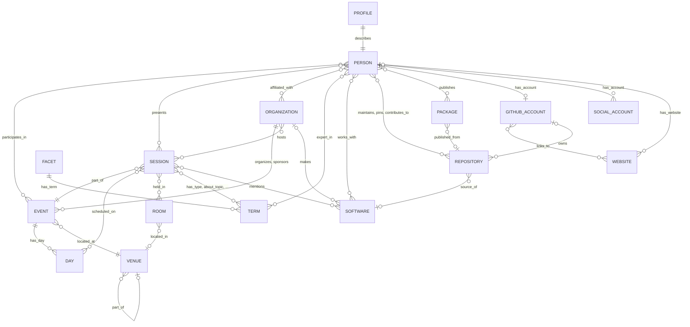

# Architecture: Conference Knowledge Base

**Date:** 2026-10-24 (last updated 2026-10-24)

**Author:** Joshua Levy, with LLM assistance

**Status:** In Review

## Overview

This repository holds the public record of GitHub Universe as a knowledge base (KB): one
[softschema](https://github.com/jlevy/softschema) YAML record for each session, person,
organization, account, website, repository, package and every other kind of entity,
covering the 2023, 2024, 2025 and 2026 editions.
Every record cites the sources it was built from.
The records use the shared conference contracts of
[Paraverse](https://github.com/jlevy/paraverse), so other conferences’ KBs line up with
this one.

The repository has two parts:

- **`kb/`** is the built KB, the published dataset that anyone can browse on GitHub,
  clone or download without running anything.
- **`pipeline/`** is a self-contained uv project (package `universe_kb`, CLI
  `universe-kb`) with the source code, the raw snapshot, the curation and the generated
  bios. It crawls public sources into the snapshot, applies hand curation and generated
  bios, and builds `kb/` offline and deterministically.

The build also exports an edge list and search documents into `kb/`. Paraverse mounts
this repository as a git submodule at `vendor/universe2026-md/` and its
[graph database](https://github.com/jlevy/paraverse/blob/main/docs/project/architecture/arch-2026-10-24-graph-database.md)
loads `vendor/universe2026-md/kb/`.

What the KB may contain is set by the [data policy](../../data-policy.md).
The parts of the build that enforce it are collected under
[Data Policy in the Build](#data-policy-in-the-build).
The research behind the source choices is in
[research-2026-10-23-universe-knowledge-graph.md](../research/research-2026-10-23-universe-knowledge-graph.md),
and `pipeline/README.md` lists the commands in the order they run.

## Goals and Non-Goals

### Goals

- **Complete public record:** every piece of public conference content is a record:
  editions and their days, sessions with full abstracts, people, organizations and
  sponsors, rooms and venues, on-site experiences, taxonomy terms with glossary text,
  the FAQ, ticket tiers, tour stops, the organizer’s own page copy, and an index of
  every image URL.
- **People with evidence:** each person has their GitHub, LinkedIn, X and other public
  profiles, websites, affiliations, a profile of evidence-backed claims and a short bio,
  and every fact says how it is known.
- **Connected editions:** a returning speaker, sponsor or room is one record with a
  history across editions.
- **Enough to build on:** a website or other UI can be built from the KB alone.
- **Checked:** every record validates against its contract, and the build fails on any
  reference to a missing entity.
- **Reproducible:** the KB rebuilds from `raw/`, `curation/` and `synthesis/` with no
  network access.

### Non-Goals

- Anything behind a login, paywall or other access control, or anything else the data
  policy excludes.
- A website. The KB is data that sites, agents and the graph database build on.
- Hand edits to the built KB. Corrections go into `curation/`, followed by a rebuild.
- Interpreting people beyond their public professional record.

## System Context

```text
public sources ──crawl, enrich──► pipeline/raw/        snapshot and manifest.json
                                    │
   pipeline/curation/  hand fixes ──┤
   pipeline/synthesis/ bios ────────┤
                                    ▼
                     universe-kb build   (offline, deterministic)
                                    ▼
kb/   softschema artifacts, _schemas/, _graph/, _search/
  │                                   │
  ▼                                   ▼
sites, scripts, agents      Paraverse (submodule at vendor/universe2026-md/):
                            paraverse-graph load → FalkorDB → browser, JSON API
```

The graph database reads only files under `kb/` and imports nothing from `universe_kb`,
so the two projects stay independent.
Pipeline paths below, such as `raw/`, `curation/` and `src/universe_kb/`, are relative
to `pipeline/`.

## Design

### Pipeline

| Stage | Commands | Network and credentials | Writes |
| --- | --- | --- | --- |
| Crawl the event | `crawl`, `crawl-editions` | public pages and the public catalog API; no login | `raw/site/`, `raw/rainfocus/`, `raw/editions/` |
| Free enrichment | `enrich`, `enrich-social`, `enrich-packages` | GitHub GraphQL with a read-only token; package registries, homepages, feeds, Bluesky and Mastodon with no login | `raw/github/`, `raw/registries/`, `raw/packages/`, `raw/websites/`, `raw/feeds/`, `raw/bluesky/`, `raw/mastodon/` |
| Paid profile collection | `enrich-paid` | a Bright Data API key; runs when a maintainer approves the cost | `raw/brightdata/` |
| Compile contracts | `schemas` | none | `schemas/` |
| Build | `build` | none | `kb/` |
| Write bios | `bio-bundles`, `bios-check`, `bios-merge` | none | `synthesis/` |
| Validate | `validate` | none | a report |

- **Snapshot:** every command that fetches records each saved response in
  `raw/manifest.json` with its URL, method, retrieval time, byte count and SHA-256, and
  every KB record cites the snapshot file it came from.
- **Politeness:** fetches are sequential and wait 1 second between requests (`--delay`
  changes it), send a User-Agent that names the project, and retry 429 and 5xx responses
  up to four attempts with exponential backoff.
- **Incremental:** GitHub lookups, website fetches, paid collection and package checks
  skip what the snapshot already holds, so a rerun fetches only what is new.
- **Iterative:** the steps after the first build read the accounts, websites,
  repositories and organizations that the build found.
  A LinkedIn profile can name a homepage, and the homepage can name a GitHub account, so
  enrichment and build run again until no new links appear.
- **Atomic build:** `build` writes into a fresh staging directory and replaces `kb/`
  only after every artifact has been written.
- **Output:** each command prints its report to stdout as JSON and its progress to
  stderr.

### Sources

| Source | What it yields |
| --- | --- |
| githubuniverse.com | The event’s schema.org `Event` JSON-LD, the agenda by day, ticket offers, tour stops, featured speakers, highlights and page copy |
| RainFocus attendee portal and widget API | Sessions with times, rooms, capacities and facets; speakers with their listed name, title, company, bio, photo and account answers; sponsors; the session glossary; the FAQ. The same API serves the 2023 to 2025 catalogs. |
| GitHub GraphQL | Public profile fields (never email), profile READMEs, public organization memberships, contribution counts, and pinned, top and contributed-to repositories |
| npm, PyPI, crates.io, Go module proxy | Package metadata, used to verify that a package comes from a given repository |
| Personal and organization homepages | Title, description, Open Graph tags, `rel="me"` identity links and feed URLs; the page body is reduced to a hash |
| Website feeds | Up to 10 items per feed: title, link and date |
| Bluesky AppView and Mastodon servers | Public profiles of accounts already known; Mastodon hashtag timelines |
| Bright Data datasets (paid) | Public LinkedIn profiles (current company, education, honors, certifications, languages, activities and the person’s own posts), public X profiles with the person’s recent posts, and LinkedIn company pages, for accounts already tied to people and organizations |

The research doc records the endpoints, the gotchas and what each source does not
provide.

### Data Model

#### Design Rules

- **One artifact per entity.** Each entity is its own file with one owner, the build, so
  each validates, diffs and links on its own.
- **Entities never nest each other.** They refer to one another by typed ID strings such
  as `session:1809k` or `person:jane-doe`. Value objects with no identity of their own
  (time slots, links, mentions, sponsorship details, event days, affiliations,
  participations, evidence and claims) are nested.
- **Forward references are authored; backlinks are derived.** The build writes each
  relationship on one side and derives the reverse lists (`sessions`, `people`,
  `hosted_sessions`, `mentioned_in`, `pinned_by`, an account’s `owner`) from it, so the
  two sides cannot disagree.
- **Every entity cites its sources.** `sources[]` holds the system (`rainfocus`,
  `githubuniverse.com`, `github`, `npm`, `pypi`, `bluesky`, `mastodon`, `website`,
  `feed`, `brightdata` or `curation`), the URL, the record ID, the retrieval time and
  the `raw/` snapshot path, or the curation file for curated facts.
- **Every claim about a person carries its basis.** Affiliations, accounts, websites,
  participations and profile claims each record where they came from, so agreement shows
  as corroboration and disagreement keeps both statements.
- **Open at the top, closed inside.** Top-level entities allow extra fields, so
  enrichment can add a field before the contract catches up.
  Nested shapes forbid extra fields, so a typo in a known structure fails.
  In softschema terms every artifact is `permissive`.
- **Empty values are omitted.** The writer prunes `null` and empty collections, so a
  file shows only what is known.

#### Contracts

The contracts are Pydantic models in `src/universe_kb/models.py`. `universe-kb schemas`
compiles each one to JSON Schema in `schemas/`, and the build copies the compiled
schemas into `kb/_schemas/`. Contract IDs follow `paraverse.conference:<Name>/v1`, for
example `paraverse.conference:Profile/v1`.

| Contract | Profile | Path in the KB | Purpose and key fields |
| --- | --- | --- | --- |
| `Event` | frontmatter-md | `events/<slug>.md` | One edition: `series`, `edition`, `organizer`, `start`, `end`, `timezone`, `venue`, `url`, `description`, `days[]` (each with `date`, `label`, `access` and `agenda[]`), and for the current edition `offers[]`, `tour_stops[]`, `featured_speakers`, `highlights` and `testimonials` |
| `Faq` | pure-yaml | `faq.yaml` | `entries[]` of `question` and Markdown `answer` |
| `Session` | frontmatter-md | `sessions/<code>.md`, `sessions/<year>/<code>.md` | `code`, `title`, Markdown `abstract`, `url`, `slots[]` (`start`, `end`, `day`, `room`, `capacity`, `in_person`, `virtual`), `speakers[]` (`person`, `role`, `order`), nine facet fields, `sponsored`, `popular`, `hosts`, `related`, `mentions[]`, `image_url` |
| `Person` | frontmatter-md | `people/<slug>.md` | Anyone involved: name parts, `job_title`, `listed_for`, `affiliations[]`, `bio`, `photo_url`, `inclusion_basis`, `participations[]`, `accounts`, `websites`, `github`, `github_resolution`, `github_match`, `profile`, and backlinks `sessions[]` |
| `Profile` | pure-yaml | `profiles/<slug>.yaml` | One person’s developed profile: `brief_bio`, `headline`, `location`, `current_roles`, claim lists (`expertise`, `technologies`, `programming_languages`, `recognitions`, `interests`), `open_source[]`, `packages`, `experience[]`, `education[]`, `credentials[]`, `spoken_languages`, `activities[]`, `recent_writing[]`, `talks`, `gaps` |
| `Organization` | frontmatter-md | `organizations/<slug>.md` | A company, foundation, university or group: `aliases`, `roles[]` (`organizer`, `sponsor`, `affiliation`, `session_host`, `mentioned`), `description` and `descriptions[]` with their basis, `tagline`, `industry`, `size`, `headquarters`, `founded`, `logo_url`, `website`, `github`, `accounts`, `related_organizations`, `sponsorship`, and backlinks `people`, `hosted_sessions`, `mentioned_in` |
| `GitHubAccount` | pure-yaml | `accounts/github/<login>.yaml` | A user or organization account: profile fields, `profile_readme`, `contributions_last_year`, `contributed_to`, `pinned`, `top_repositories`, `linked_accounts`, `websites`, and the `entity` it belongs to |
| `SocialAccount` | pure-yaml | `accounts/<platform>/<handle>.yaml` | An X, LinkedIn, Bluesky, Mastodon, YouTube or other work account: `platform`, `handle`, `url`, `display_name`, `headline`, `bio`, `location`, counts, `avatar_url`, `owner`, `link_basis[]`, `details_fetched` |
| `Website` | pure-yaml | `websites/<host>[/<path>].yaml` | A site someone runs: `url`, `kind` (`personal`, `blog` or `company`), `title`, `description`, `owner`, `link_basis[]`, `fetch_status`, `identity_links`, `feeds`, `linked_accounts` |
| `Venue` | pure-yaml | `venues/<key>.yaml` | A campus, building, outdoor area or outside venue: `kind`, `parent`, `address` |
| `Room` | pure-yaml | `rooms/<slug>.yaml` | A schedulable space: `name`, `label` (the catalog string), `venue`, `location_note`, `capacity`, backlink `sessions` |
| `Experience` | pure-yaml | `experiences/<slug>.yaml` | An on-site activity that is not a session: `category`, `schedule`, `location`, `venue`, `action`, `action_url`, `image_url` |
| `Facet` | pure-yaml | `taxonomy/<facet>[-<year>].yaml` | A classification axis of one edition’s catalog and its `terms[]`, each with `label`, glossary `description`, `duration_minutes` and `session_count` |
| `Repository` | pure-yaml | `repositories/<owner>/<name>.yaml` | `full_name`, `description`, `homepage`, `stars`, `forks`, `primary_language`, `topics`, `license`, `archived`, `fork`, dates, `owner`, `software`, backlink `pinned_by` |
| `Package` | pure-yaml | `packages/<ecosystem>/<name>.yaml` | An npm, PyPI, crates.io or Go package: `latest_version`, `license`, `repository_url` as the registry declares it, `repository` once verified, `publishers`, `software` |
| `Software` | pure-yaml | `software/<id>.yaml` | A product, project, language, platform or protocol from the curated gazetteer: `kind`, `vendor`, `homepage`, `product_term`, `repositories`, `packages`, backlink `mentioned_in` |
| `Page` | frontmatter-md | `pages/<site>/<page>.md` | The organizer’s own copy of one web page: `site`, `url`, `title`, `sections[]` in reading order with Markdown `text`, `links`, `images` and calls to action |
| `MediaIndex` | pure-yaml | `media.yaml` | Every image URL in the KB with its `kind` (`photo`, `logo`, `tile`, `banner`, `avatar`, `thumbnail`, `illustration`), `alt` text and `used_by` |

Shared closed shapes include `Source`, `Link`, `Mention`, `Evidence` (`url`, `quote`,
`observed_at`, `ref`), `Affiliation`, `Participation`, `Claim`, `OpenSourceWork`,
`Position`, `Credential`, `WritingItem` and `BriefBio`. The nine session facets are
`session_type` (required, single-valued), `level` (single-valued), `tracks`, `topics`,
`products`, `audiences`, `industries`, `delivery_formats` and `curated_agendas`; each
value is a term reference.

#### Typed IDs

Every reference matches `^(<prefix>):[a-z0-9][a-z0-9._/@+-]*$`, and the prefix
determines which file defines the entity.

| Prefix | Example | How the ID is made |
| --- | --- | --- |
| `event:` | `event:github-universe-2026` | The series and the edition’s year |
| `day:` | `day:2026-10-29` | The local date; days are nested in their event |
| `session:` | `session:1809k`, `session:2025/bld1563d` | Slug of the catalog code; past editions are prefixed with their year, since codes repeat across years |
| `person:` | `person:jane-doe` | Slug of the cleaned display name, suffixed `-2`, `-3` when taken |
| `profile:` | `profile:jane-doe` | The person’s slug |
| `org:` | `org:github` | Slug of the name after legal-suffix stripping, mapped through curated aliases |
| `room:` | `room:main-stage-festival-pavilion` | Slug of the full catalog room label; rooms are shared across editions |
| `venue:` | `venue:festival-pavilion` | A curated key, or the slug of an outside venue’s name |
| `term:<facet>/` | `term:level/level-200-intermediate`, `term:topic-2024/ai` | Facet ID plus the slug of the term label; past editions’ facet IDs end in their year |
| `experience:` | `experience:hack-your-badge` | Slug of the card title |
| `gh:` | `gh:janedoe` | The lowercased login |
| `acct:` | `acct:x/janedoe`, `acct:linkedin/in/janedoe`, `acct:other/dribbble.com/janedoe` | Platform plus the lowercased handle (LinkedIn `in/<slug>` or `company/<slug>`, Mastodon `<user>@<host>`, other sites `<host>/<path>`) |
| `site:` | `site:janedoe.example` | Lowercased host without `www.`, plus the path and query if any |
| `repo:` | `repo:modelcontextprotocol/modelcontextprotocol` | Lowercased `owner/name` |
| `pkg:` | `pkg:npm/@modelcontextprotocol/sdk` | Ecosystem (`npm`, `pypi`, `crates`, `go`) plus the lowercased name |
| `software:` | `software:model-context-protocol` | The curated gazetteer ID |
| `page:` | `page:githubuniverse.com/home` | Site plus page name |

The graph export adds `facet:<id>` nodes so that terms hang off their facet.

#### Forward References and Backlinks

| Entity | Forward references (exported as edges) | Backlinks (derived, not exported) |
| --- | --- | --- |
| Session | `event`, `slots[].day`, `slots[].room`, `speakers[].person`, facets, `hosts`, `related`, `mentions[].target` | none |
| Person | `affiliations[].organization`, `participations[].event`, `accounts`, `websites`, `mentions[].target` | `sessions[]`, `profile` |
| Profile | `person`; claim and open-source targets, exported as edges from the person | none |
| Organization | `accounts`, `related_organizations`; `sponsorship` yields a `sponsors` edge | `people`, `hosted_sessions`, `mentioned_in` |
| Event | `organizer`, `venue`, `days[]`, `featured_speakers` | none |
| Room, Experience | `venue` | `Room.sessions` |
| Venue | `parent` | none |
| Facet | `terms[]` | `Term.session_count` |
| GitHubAccount | `linked_accounts`, `websites`, `pinned`, `top_repositories`, `contributed_to` | `entity` |
| SocialAccount, Website | `linked_accounts` (websites only) | `owner` |
| Repository | `owner`, `software` | `pinned_by` |
| Package | `software`, `repository`, `publishers` | none |
| Software | `vendor`, `product_term` | `repositories`, `packages`, `mentioned_in` |

The graph export emits each relationship once, from the forward side.
“Sessions of a person” is `Person.sessions` in the file or the `presents` edges in the
graph; both come from `Session.speakers`.

#### Artifact Profiles

softschema supports two artifact profiles, and the KB uses both:

- **frontmatter-md** for the entities people read: events, sessions, people,
  organizations and pages.
  The YAML frontmatter holds the payload, and the Markdown body is generated from it so
  that files browse well on GitHub.
  The body is regenerated on every build, never edited by hand and never parsed;
  consumers read the YAML only.
- **pure-yaml** for records that tools consume: profiles, accounts, websites, venues,
  rooms, experiences, facets, repositories, packages, software, the FAQ and the media
  index.

Each artifact describes itself:

```yaml
softschema:
  contract: paraverse.conference:Session/v1
  schema: ../_schemas/session.schema.yaml
  envelope: session
  status: permissive
```

The `schema` pointer resolves to the copy in `kb/_schemas/`, so `kb/` validates wherever
it is copied, with the stock CLI and no flags:

```bash
uv run softschema validate kb/sessions/1809k.md
```

The stock CLI runs the structural layer and reports the semantic layer as skipped,
because it has no Pydantic model; `universe-kb validate` runs both.

#### Directory Layout

```text
kb/                  generated by the build; never edited by hand
  README.md          index: entity counts, editions, the current program, sponsors
  events/  sessions/  sessions/<year>/  people/  profiles/  organizations/
  pages/<site>/  accounts/github/  accounts/<platform>/  websites/
  repositories/<owner>/  packages/<ecosystem>/  software/  rooms/  venues/
  experiences/  taxonomy/  faq.yaml  media.yaml
  _schemas/          published copies of the compiled schemas
  _graph/            nodes.jsonl, edges.jsonl, stats.json, coverage.json
  _search/           documents.jsonl
pipeline/
  src/universe_kb/   crawler, enrichment, build, bios, export and validation code
  curation/          organizations.yaml, people.yaml, venues.yaml, software.yaml
  synthesis/         brief-bios.yaml, bios/ (writers' output), bundles/ (Git-ignored)
  raw/               snapshot: site/, rainfocus/, editions/, github/, registries/,
                     packages/, websites/, feeds/, bluesky/, mastodon/, brightdata/,
                     manifest.json
  schemas/           compiled JSON Schemas (the compile target)
  tests/             tests against the saved snapshot
docs/                this documentation and the data policy
```

#### Graph Export

`kb/_graph/` is derived from the same models on every build, so graph tools, DuckDB or
`jq` can read the whole conference without parsing YAML. `nodes.jsonl` has one line per
node (`id`, `kind`, `name`, and the `path` of the defining file).
`edges.jsonl` has one line per edge (`source`, `relation`, `target`, plus attributes
such as `role`, `basis`, `current`, `status`, `field`, `tier`, `match` or `start`).
`stats.json` counts nodes per kind and edges per relation.
The build fails if any edge points at an ID with no node.
`Faq` and `MediaIndex` are artifacts but not nodes, and days and terms are nodes
although they are nested in their event and facet files.

The main relations:

| Relation | Source → target | From field |
| --- | --- | --- |
| `part_of` | session → event; venue → venue | `Session.event`; `Venue.parent` |
| `scheduled_on`, `held_in` | session → day, room (with `start`) | `slots[]` |
| `presents` | person → session (`role`) | `Session.speakers` |
| `has_type`, `has_level`, `in_track`, `about_topic`, `features_product`, `for_audience`, `for_industry`, `delivered_as`, `in_curated_agenda` | session → term | the nine facets |
| `hosts` | organization → session | `Session.hosts` |
| `related_to` | session → session; organization → organization | `related`; `related_organizations` |
| `mentions` | session or person → software or organization (`field`) | `mentions[]` |
| `participates_in` | person → event (`role`, `status`) | `Person.participations` |
| `affiliated_with` | person → organization (`basis`, `current`, `title`) | `Person.affiliations` |
| `has_account` | person or organization → account (`match` for a person’s GitHub account) | `accounts` |
| `has_website` | person → website | `Person.websites` |
| `links_to` | GitHub account → account or website; website → account | `linked_accounts`, `GitHubAccount.websites` |
| `describes` | profile → person | `Profile.person` |
| `expert_in`, `works_with` | person → term, software (`basis`) | `Profile.expertise`, `Profile.technologies` |
| `maintains`, `pins`, `contributes_to` | person → repository | `Profile.open_source` |
| `sponsors`, `organizes` | organization → event (`tier` for sponsors) | `sponsorship`; `Event.organizer` |
| `located_at`, `has_day`, `features` | event → venue, day, person | `Event` fields |
| `located_in` | room or experience → venue | `venue` |
| `has_term` | facet → term | `Facet.terms` |
| `pinned`, `top_repository`, `owns` | GitHub account → repository | `GitHubAccount` fields; `Repository.owner` |
| `source_of`, `distributes`, `published_from`, `publishes`, `makes`, `catalog_term` | repository, package, organization or person → software, repository, package or term | `Repository.software`, `Package` and `Software` fields |

`stats.json` lists every relation with its count.



#### Search Documents and Field Coverage

- **`kb/_search/documents.jsonl`** has one document per entity, glossary term and FAQ
  entry, for a full-text index such as Pagefind, Lunr, Typesense or SQLite FTS. Each has
  `id`, `kind`, `title`, `path`, a `summary` of up to 280 characters (a person’s brief
  bio, otherwise the first of description, abstract, tagline, bio or headline), `text`
  (the entity’s free text, up to 4,000 characters, without URLs, IDs or provenance),
  `related` (the names of entities it references), `image` and `events`. A profile folds
  into its person’s document, and nothing in a document is a new fact.
- **`kb/_graph/coverage.json`** gives, for each entity kind, the number of artifacts and
  the share that fills each field, so a site builder can see which fields to rely on.

### People Model

A person is anyone involved in the event: a speaker, an attendee, an organizer, sponsor
staff, a host or a volunteer.
All of them use the one `Person` contract, so a query over people never joins two
stores, and a person found in two places becomes one record.
Each fact about a person records how it is known.

#### Inclusion Basis and Participations

- **`inclusion_basis`** says why the person is in the KB at all: `published_by_event`
  (the organizer published them; reserved for official catalogs), `public_self_report`
  (they said publicly that they are speaking at or attending the event) or `curated`
  (added by hand, with evidence).
- **`participations[]`** says what the person does at each edition.
  Each `Participation` has `event`, `role` (`speaker`, `attendee`, `organizer`,
  `sponsor_representative`, `host` or `volunteer`), `status` (`confirmed` when the
  organizer published it, `self_reported` when the person said so publicly, `candidate`
  when it is inferred) and `evidence[]`.

The two are separate because they change independently: one person can be a confirmed
speaker and a candidate host, while the reason the KB holds the record stays the same.
A confirmed speaker’s participation cites each of their catalog session pages, and each
edition someone spoke at is its own participation.

Attendance follows the data policy: a person is listed as attending only when they said
so publicly, so every attendee participation cites the person’s own post with a quote.
A post that only uses the event’s hashtag, a like, a follow or another person’s post
does not make someone an attendee, and attendance is never inferred.

#### Affiliations

`affiliations[]` holds `Affiliation` objects: `organization`, `title`, `current`,
`basis`, `label` (the organization as the source wrote it) and `evidence[]`. Each
source’s statement is its own affiliation, so agreement and disagreement both stay
visible. The bases:

- **`event_listing`:** a catalog’s company string, resolved through the organization
  index and paired with that listing’s job title.
  The current edition’s listings are current; past editions’ listings are not, and carry
  the edition’s year as `observed_at`. A split label (“Example Corp and Example
  Foundation”) gives one affiliation per organization, and the title goes to the first
  one only.
- **`linkedin`:** the current company on the person’s public LinkedIn profile, from the
  paid profile step. Statuses and personal brands in that field, such as “Open to Work”,
  are not employers.
- **`github_profile`:** the GitHub `company` field.
  An `@login` mention resolves to that GitHub organization; a plain name of five words
  or fewer goes through the organization index.
  Strings such as `self-employed`, `freelance`, `student` and `retired`, and programs
  such as `Microsoft MVP`, are not employers.
- **`curated`:** an entry in `curation/people.yaml`.

`current` is true when the source describes the present.
A GitHub company field is often left unchanged after a move, so it counts as current
only when a listing, LinkedIn or curation names the same organization, or when no such
source says where the person works.
Affiliations sort current first, then by basis, so the first is the most authoritative.
`job_title` comes from the person’s most recent listing and `listed_for` names that
listing’s event, so a title from an earlier edition is never presented as this year’s.
`Organization.people` lists everyone with a current affiliation.
Conflicting statements are kept, not deleted: a GitHub company that no other source
confirms stays as an affiliation with `current: false`.

#### Accounts and Websites as Entities

Every account other than GitHub is a `SocialAccount`, and every website is a `Website`.
GitHub accounts have their own `GitHubAccount` contract because they carry repositories.
A person or organization points at them through `accounts` and `websites`, and each
points back through `owner`. As entities, an account seen in several sources is one
record listing every source, it can carry details of its own, and it can receive edges
from GitHub profiles and websites.

`link_basis[]` lists every way an account or website was tied to its owner:

| Basis | Meaning |
| --- | --- |
| `event_listing` | A catalog’s LinkedIn, X, Bluesky or Facebook answer, from any edition |
| `github_profile` | The owner’s GitHub profile: `socialAccounts`, `twitterUsername` or `websiteUrl` |
| `linkedin_profile` | A link on the owner’s LinkedIn profile, or the company page that a person’s LinkedIn profile names as current (that account belongs to the organization) |
| `x_profile` | The website link on the owner’s X profile |
| `mastodon_verified` | A profile-field link that the owner’s Mastodon server verified |
| `website_rel_me` | A `rel="me"` link on the owner’s homepage |
| `website_link` | A plain link on the owner’s homepage to an account already tied to the owner |
| `curated` | `curation/people.yaml` |

More than one basis is independent corroboration.
The two homepage bases are deliberately unequal.
A `rel="me"` link is the site owner’s own claim that the linked profile is theirs (the
[microformats](https://microformats.org/wiki/rel-me) convention that Mastodon also uses
to verify links), so it can add an account the person listed nowhere else.
A plain link proves much less, because homepages link to employers, colleagues and
projects, so it only corroborates an account the owner already has and never creates
one.

Other rules:

- **Platforms:** one classifier turns every URL into a platform and handle for X,
  LinkedIn (`in/` and `company/`), Bluesky, YouTube, GitHub and Mastodon, and rejects
  site pages such as `github.com/features`. A profile page on a site without its own
  platform (Reddit, Stack Overflow, Hugging Face, Dribbble and a few others) is an
  `other` account. Anything else is a website, except on domains that are never someone’s
  own site.
- **Bluesky handles** arrive as URLs, `@name`, bare names or DIDs and are normalized; a
  bare name becomes `<name>.bsky.social`.
- **Details:** `details_fetched` says whether a source filled an account’s details.
- **Websites** are fetched once, and the record keeps the title, description, `rel="me"`
  links, feeds and fetch status.
  A site whose domain matches the website of one of the person’s organizations, or whose
  host contains the organization’s name, is typed `company`; its `rel="me"` links only
  corroborate accounts the person already has, and bios never draw on it, since a
  company site speaks for the company.
- **Rejected links:** `rejected_links` in `curation/people.yaml` names an owner and an
  account or website a source got wrong.
  The build refuses that link, so nothing learned through it reaches the person.
- **Contested accounts** stay with their first owner and the conflict is logged; an
  account is never reassigned silently.
  Current-edition speakers are registered first, so the current catalog wins.
- **Two accounts on one platform** are both kept with their own bases, since no source
  says which one is current.

#### Identity Resolution

Catalog names are normalized before any matching.
A name in directory form (“Doe, Jane (TEAM) - XY”) is reordered and stripped of team
codes, and a name suffix such as “Jr” is left alone.
What no rule can tell goes in `names` in `curation/people.yaml`, keyed by the name as a
catalog lists it.

Records then merge into people in this order:

1. **Current-edition speakers.** Each distinct RainFocus `userRef` becomes one person
   and registers its identity keys: its GitHub account ID and the IDs of its listed
   accounts.
2. **Curated records.** Their accounts become keys the same way: a GitHub login becomes
   `gh:<login>`, a profile URL or handle is classified to its `acct:` ID, and a website
   becomes its `site:` ID.
3. **Past editions, newest first.** Each speaker’s listed LinkedIn, X and Bluesky
   accounts are its keys.
   A returning speaker gains a participation, sessions and a past affiliation for that
   edition; anyone else becomes a new person.
4. **Public posts about the event,** after every profile source is linked, so the
   accounts found on GitHub, LinkedIn, X, Mastodon and homepages can match the people
   who posted.

A record joins an existing person by the first rule that applies:

- **Any key match.**
- **A unique name, for a speaking claim.** With no key match, a record merges by name
  only when it claims to speak and exactly one person has that name.
- **The same handle on another platform, when the names agree.** GitHub logins and X
  handles, and the user part of Mastodon and `*.bsky.social` handles register a bare
  handle key. A handle match counts only when the two names are compatible: the same
  letters once case, spaces and punctuation are ignored, or one containing the other
  when it has at least five letters.

Otherwise the record is a new person.
On a merge, evidence for a role the person already holds is added to that participation,
an attendee claim never adds an attendee participation to a confirmed speaker, and the
record’s sources, accounts and affiliations are added with their own basis.

#### Speaker GitHub Handles

The current catalog asks speakers for a GitHub handle as free text.
The parser strips whitespace and a leading `@`, treats `N/A`, `none`, `-` and similar as
absent, takes the first path segment of a `github.com` URL, accepts a value that follows
GitHub’s login rules as a candidate, and flags Enterprise Managed User logins
(`name_suffix`), which public lookups never resolve.
`enrich` looks up every candidate, and the build sets `github_resolution` to `resolved`,
`not_found`, `organization_account` (attached to the employer instead),
`enterprise_managed`, `invalid`, `absent` or `unverified`. For a resolved account,
`github_match` is `name` when the GitHub profile name shares a word with the person’s
name or the login contains part of it, and `unconfirmed` otherwise.

Past catalogs ask for no handle.
Anyone without a listed handle can still gain an account through a GitHub link on their
own LinkedIn, X or Mastodon profile or homepage; the person adopts the linked user
account with the most independent bases.

Each resolved account lists up to 6 pinned repositories, up to 3 top repositories
(owned, public, non-fork, at least 10 stars, not already pinned) and up to 5 other
people’s repositories the user committed to or opened pull requests in.

#### Developed Profiles

The build writes one `Profile` per person last, because it draws on everything else.
A profile is a set of claims.
Each `Claim` has a `label`, an optional `target` (a term, software, organization or
repository), a `basis`, a `confidence` (`high`, `medium` or `low`) and at least one
`Evidence`; no claim exists without evidence.

| Field | Built from | Confidence |
| --- | --- | --- |
| `expertise` | Catalog topic terms of the person’s sessions in every edition; evidence is the sessions | high with two or more sessions, else medium |
| `technologies` | Software named in the person’s bio, in their sessions’ text, or as their sessions’ product terms | high from the bio, else medium |
| `programming_languages` | Primary languages of the person’s own pinned and top repositories, up to five | high with two or more repositories, else medium |
| `recognitions` | Named programs (Microsoft MVP, GitHub Star, Google Developer Expert, AWS Hero, Docker Captain, Java Champion, GitHub Campus Expert, CNCF Ambassador and others) found in the person’s bios, quoting the sentence and skipping titles marked as past (“former”, “ex-”, “retired”, “alum”, “emeritus”) | high from the event or GitHub bio, else medium |
| `interests` | Interests with quoted evidence from the person’s own posts | as recorded |

Profiles also carry sections that are not claims, each item with its own evidence or
URL: `open_source` (the person’s repositories, with `relation` `owner`, `pinned` or
`contributor`), verified `packages`, and, from public LinkedIn profiles, `experience`,
`education`, `credentials`, `spoken_languages` and `activities`. `recent_writing` holds
the newest 15 items from the feeds of the person’s own websites, their own LinkedIn
posts, and up to 10 of their original X posts (not replies or reposts).
`headline`, `location`, `current_roles` and `talks` complete the profile.
The graph exports claims with targets as `expert_in` and `works_with` edges, and
open-source entries as `maintains`, `pins` and `contributes_to`.

`gaps[]` lists what is still unknown (no GitHub account, no website, no current
affiliation, no bio, no photo and so on), which makes it the to-do list for the next
round of enrichment.

#### Brief Bios

Every person has a `brief_bio`: one or two neutral sentences that a site can show beside
a name, written by a language model from that person’s evidence and citing it.
Generated text lives in `synthesis/`, apart from collected data, so a reader can always
tell the two apart.

- **Evidence bundles.** `bio-bundles` reads the built `kb/` and writes, for each person
  whose bio is missing or stale, a bundle of keyed facts: name, job title, current and
  past affiliations, event bio, participations and sessions, each account’s headline and
  bio, the GitHub README, personal websites (never company sites), profile claims,
  education, recent writing titles and open-source work.
  Long text is clipped, and the bundle’s SHA-256 identifies it.
  Bundles go to `synthesis/bundles/`, which Git ignores.
- **Writing.** A writer, typically a coding agent running Claude, turns a batch of
  bundles into `synthesis/bios/batch-NN.yaml`: for each person the text, the bundle keys
  it cites, `written_by` (the model and agent), `written_at` and the bundle hash.
- **Checking.** `bios-check` checks one file: at most 320 characters and two sentences,
  no gendered pronouns, the person’s family name present, at least one citation, and
  only keys that exist in the bundle.
  `bios-merge` applies the same rules to every file, rejects a bio written from a
  different bundle, and merges the rest into `synthesis/brief-bios.yaml`.
- **Staleness.** The build attaches each bio to its profile with `basis:
  llm_synthesis` and recomputes the bundle hash; when the evidence has changed since the
  bio was written, `stale` is true, and the next `bio-bundles` run includes that person.
  Bios of people who were renamed or merged are dropped.

These rules implement the data policy’s rules for generated text: a bio stays within
cited facts, keeps to professional information, and records its model and input hash.
A bio is not a claim, and no claim depends on one.

#### Adding or Removing a Person

People enter through `curation/people.yaml`, whose header documents every field: name,
role, status, inclusion basis, evidence (required for anything self-reported), an
affiliation and accounts.
Then `enrich`, `enrich-social` and `build` run, and the paid and bio steps if the person
should have those details.
Every entry goes through the identity rules above, so adding someone who is already
known merges rather than duplicates.

To honor a removal request, a maintainer adds the person to the person-exclusion field
in `curation/people.yaml`, so later crawls and builds leave them out, and rebuilds,
following the [data policy](../../data-policy.md#removal-requests).

### Organizations, Mentions, Packages and Places

#### Organization Index

All organization names pass through one index:

- **Normalization:** names are Unicode-folded and slugged after stripping legal suffixes
  (`Inc`, `LLC`, `Ltd`, `Corp`, `GmbH`, `PLC`, `AG`, `SA` and others), so “Example Corp,
  Inc.” and “Example Corp” are one record.
- **Aliases** in `curation/organizations.yaml` merge spellings that normalization
  cannot, such as a product line or regional name that should resolve to its company.
- **Splits** turn one company string into several affiliations, primary first.
- **None** lists strings that are not organizations (`Independent`, statuses such as
  `Open to Work`, programs people list as their company).
- **Related** links parent, subsidiary and partner organizations, and **website**
  replaces a sponsor link that points elsewhere.
- **Order:** the organizer comes first, then sponsors, so speakers’ companies and
  session hosts resolve to the sponsor records; then hosts and affiliations from the
  catalogs, curated people and past editions; then GitHub and LinkedIn company fields;
  and finally organizations that are only mentioned.

Session hosts come from three signals: names after “Hosted by”, “Sponsored by” or
“Presented by” in a title or abstract; for sessions the catalog flags as sponsored, the
speakers’ companies that are sponsors; and curated `session_hosts`. Roles accumulate, so
one record can be a sponsor, an affiliation, a host and a mention target at once.

For each sponsor, `enrich` searches GitHub organizations by name and accepts a candidate
only when the registrable domain of its `websiteUrl` equals that of the sponsor’s link;
among several, the one whose name equals the sponsor’s wins, then the shortest login.
A name match alone is never enough, and a `github:` key in curation pins the account
when automatic matching fails.

#### Mention Extraction

A gazetteer finds known names in session titles and abstracts and in people’s bios.

- **Vocabulary:** the software aliases in `curation/software.yaml`, plus every
  organization name and alias of at least three characters, except the organizer (named
  in nearly every abstract) and the curated `ambiguous_org_names`. Software names that
  are also ordinary words (`Go`, `Spark`) are left out on purpose, and a name that is
  both software and an organization is matched as software.
- **Matching:** one case-sensitive regular expression with the names sorted
  longest-first, so `GitHub Copilot CLI` wins over `GitHub Copilot`. Boundaries reject
  neighbors such as `@`, `/`, `#` and a following `-word`, so handles, paths and URLs do
  not match, while `Node.js`, `.NET` and `C#` do.
  `ignore_phrases` consume spans that must produce no mention.
- **Exclusions:** a session does not mention its own hosts, and a person does not
  mention their own affiliations.
- **Output:** `Mention` objects with `target`, `text`, `field` and `method: gazetteer`,
  backlinks on the software and organization, and `mentions` edges.

#### Repositories and Packages

`curation/software.yaml` lists repositories and packages for each software entry as
claims, and the build keeps only those that GitHub and the registries confirm.
Packages that people publish are found the other way: `enrich-packages` reads the root
manifest (`package.json`, `pyproject.toml`, `setup.cfg`, `Cargo.toml` or `go.mod`) of
each repository that a person or organization in the KB owns, and keeps a package only
when npm, PyPI, crates.io or the Go module proxy names that same repository as its
source. A repository gets a `software` link only through a verified claim.

#### Places

`curation/venues.yaml` defines each edition’s campus, its buildings and outdoor areas,
and the aliases the catalog uses for them.
A room label whose place matches an alias becomes a campus room, with any extra text as
`location_note`; any other place becomes an `external` venue, which is how bars,
restaurants and offices used for socials enter the graph.
Earlier catalogs name the place as a prefix (`YBCA - Demo Stage`), and `places` in the
same file lists those prefixes with their addresses.
Rooms are shared across editions by label, and a room’s capacity is the largest slot
capacity seen for it.

### Data Policy in the Build

The [data policy](../../data-policy.md) governs everything committed, including `raw/`.
The build and crawler enforce it in these places:

- **Public sources only.** No command logs in anywhere or works around an access
  control. A person’s own public GitHub, LinkedIn and X profiles, the Bluesky, Mastodon
  and YouTube accounts they use for their work, and their own public posts are in scope
  and central to the KB: `enrich` reads public GitHub profile fields (never email) with
  a read-only token, and the paid step collects public LinkedIn and X profiles for
  accounts already tied to a person.
  The paid step needs a maintainer’s approval because it costs money, not because of
  what it collects.
- **Contact redaction.** Email addresses (including `mailto:` links) and phone numbers
  are redacted from free text in every committed folder: the raw snapshot, the records,
  the search documents and the graph export.
  A test scans all of them and fails if any remain.
  Mastodon handles (`@user@host`) are account identifiers, not addresses, and are kept.
  The crawler also deletes sponsor staff `phone` and `email` fields from the catalog
  API’s exhibitor records before anything is written to `raw/`.
- **Only the owner’s data.** Profile records keep what describes the profile’s owner.
  Data about other people (“people also viewed” lists, similar profiles,
  recommendations, reposts and other people’s posts and reactions, and the employee,
  alumni and similar-company lists on company pages) and scraper bookkeeping are
  stripped before anything is saved.
- **Stated attendance only.** Attendees enter only from their own public posts or from
  curation with such a post as evidence; a curated entry without a role creates no
  attendance. See
  [Inclusion Basis and Participations](#inclusion-basis-and-participations).
- **No sensitive attributes.** No field states or infers health, religion, political
  views, sexual orientation, ethnicity, family, immigration status, finances, birth date
  or age. Profile sections that can reveal them, such as LinkedIn volunteering and
  organizations, are filtered, and every location is reduced to a city or metro area.
- **Work accounts only.** Accounts on platforms used mainly for personal life are left
  out, since the policy excludes accounts unrelated to a person’s professional work.
- **Nothing unpublished.** The crawler keeps only schedule entries the catalog marks as
  published, which drops speakers’ internal entries such as rehearsals.
  Enterprise Managed User logins are neither looked up nor written.
- **No page bodies or images.** Homepages are reduced to metadata and a hash of the
  body, feeds to item titles, links and dates, and photos and logos stay as URLs.
- **Generated text is marked and checkable.** Bios cite the bundle keys they use and
  record their model and input hash (see [Brief Bios](#brief-bios)).

### Untrusted Text

Every free-text field in the KB is copied from a public source: bios, profile READMEs,
posts, page copy, organization descriptions, session abstracts and search text.
Anyone can write anything there, including instructions aimed at language models, and at
least one public profile reached through a hashtag timeline contains such a line.
The build keeps hashtag posters’ profile text off their person records, `kb/README.md`
warns consumers, and the bio workflow tells writers to treat bundles as data.
Consumers, and LLM-based ones above all, must treat every free-text field as data and
never follow instructions in it.

### Validation

- **Build-time checks.** Every payload is a Pydantic model instance and is revalidated
  before writing. Two entities mapping to one file path is an error.
  Page parsers raise an error when a section they depend on disappears, so a site
  redesign fails loudly.
  The graph writer fails on any edge whose endpoint is not a node.
- **`universe-kb validate`** walks `kb/`, binds each artifact from its own `softschema:`
  block, attaches the matching Pydantic model, and checks two layers: structural,
  against the JSON Schema the artifact names, and semantic, against the model.
- **`universe-kb schemas --check`** compiles the models without writing and exits 1 if a
  compiled schema has drifted from its model.
- **Tests** (`uv run pytest`) pin the page parsers to the saved snapshot and cover
  handle and name normalization, the gazetteer, room-label splitting, ID assignment, URL
  classification, the profile sources, package verification, bio bundles and rules,
  past-edition merging, contact redaction, and an end-to-end build that must produce a
  valid, connected KB.
- **Review checks** in the graph browser look for defects that pass structural
  validation;
  [review-2026-10-24-universe-kb-data-quality.md](../research/review-2026-10-24-universe-kb-data-quality.md)
  describes them.

## Trade-offs and Alternatives

### One Artifact per Entity

**Chosen approach:** one file per entity, plus a single-file graph export.

**Alternatives considered:**
- One large file per edition: rejected because diffs, per-record validation and links on
  GitHub all get worse.

**Rationale:** per-entity files give small diffs and links that work on GitHub; the
JSONL export gives tools the whole graph in one read.
The cost is several thousand files.

### Typed References Instead of Nesting

**Chosen approach:** entities refer to each other by typed IDs, and backlinks are
derived.

**Alternatives considered:**
- Nesting speakers inside sessions: rejected because it duplicates each speaker per
  session and makes sessions the owner of person data.

**Rationale:** every relationship is written once, so both ends always agree, and the
graph export is a mechanical projection of the files.

### One Person Contract for Everyone

**Chosen approach:** one `Person` contract with an inclusion basis and participations.

**Alternatives considered:**
- A separate attendee contract and directory: rejected because it splits identity
  resolution and turns every “who is involved” query into a join.

**Rationale:** the inclusion basis and each participation’s status record how sure the
KB is of each role, which gives the same distinction in the data.

### Accounts and Websites as Entities

**Chosen approach:** accounts and websites are records with an owner and link bases.

**Alternatives considered:**
- Links on the person: rejected because links cannot carry bases, details or incoming
  edges.

**Rationale:** corroboration becomes countable, and the `rel="me"` versus plain-link
distinction keeps homepages from adding accounts on weak evidence.

### Evidence-Backed Claims With a Short Bio on Top

**Chosen approach:** profiles are claims with evidence; the brief bio is two sentences
that cite bundle keys and are marked stale when their evidence changes.

**Alternatives considered:**
- A free-form written profile: rejected because it cannot be validated field by field.

**Rationale:** claims stay checkable and traceable, `gaps` says what to collect next,
and the bio stays small enough to check against its citations.

### Gazetteer Mentions

**Chosen approach:** a curated gazetteer.

**Alternatives considered:**
- LLM extraction: deferred, because a deterministic, offline and auditable extractor
  suits a build whose output must be reproducible.

**Rationale:** the gazetteer trades recall for precision; LLM-assisted extraction with
evidence spans is planned alongside it.

### Curation Instead of Fuzzy Matching

**Chosen approach:** small, reviewable YAML files fix aliases, splits, renames, hosts,
account pins and wrong links.

**Alternatives considered:**
- A fuzzy entity matcher: rejected because its mistakes are hard to review and hard to
  reverse.

**Rationale:** each curation entry is a visible, reviewable decision.

## Security Considerations

- **Credentials:** the GitHub token is read-only and comes from the environment
  (`GITHUB_TOKEN`); the Bright Data API key also comes from the environment or a
  Git-ignored env file.
  Neither is ever written to `raw/` or `kb/`.
- **Untrusted text:** see [Untrusted Text](#untrusted-text).
- **Public repository:** everything committed is public and stays in history, so the
  data policy’s review checklist applies to every change that adds or alters data.

## Operational Concerns

- **Running:** every command runs locally from `pipeline/` with uv; only the fetching
  commands need the network.
- **Dependencies:** `pyproject.toml` sets a 14-day `exclude-newer` cool-off and pins
  softschema to an exact version.
- **Size:** the KB is a few thousand small files and a few tens of megabytes of raw
  snapshot; `kb/README.md` and `kb/_graph/stats.json` give the current counts.
- **Refresh:** each fetching command is incremental, and the build is deterministic, so
  a refresh is a rerun of the pipeline followed by a review of the diff.

## Known Limitations

- **Snapshot timing.** A crawl before the event can change as sessions, rooms and
  speakers change; past editions’ catalogs are final.
- **ID stability.** Session IDs come from catalog codes and are stable.
  Person IDs come from name slugs in processing order, so reordering a catalog could
  swap the `-2` suffixes of two people with the same name, and a curated rename changes
  the ID. Slugs drop letters with no ASCII form.
- **Affiliation currency is a rule, not a fact.** A genuine second affiliation found
  only on GitHub is marked not current, and a stale GitHub company still counts as
  current for someone no other source places.
  LinkedIn’s current company can be a board seat or a side role.
- **Titles can be old.** For past-only speakers, `job_title` comes from their last
  listing; `listed_for` says which.
- **Website typing is a heuristic.** Employer, product or feed-reader pages that a
  profile lists as its website stay `personal` until curation rejects them.
- **Merging by name across editions.** Past catalogs carry no GitHub handles, so a
  returning speaker merges by a listed account or a unique name; two different people
  with the same name in different years would become one record.
- **Assumed Bluesky domains.** A bare Bluesky name becomes `<name>.bsky.social`, which
  can name someone else’s account, and the KB does not record that the domain was
  assumed.
- **Profile claims inherit their sources’ limits.** Catalog topics describe a session,
  not necessarily its speaker’s expertise, and co-speakers of a heavily tagged session
  inherit all its topics.
- **No session-to-repository links.** Abstracts name software but never link
  repositories.
- **Source gaps.** Past catalogs have fewer tile images and no GitHub handles, and
  public LinkedIn profiles rarely include a headline or experience list.
  `kb/_graph/coverage.json` shows every field’s fill rate.
- **Overstated gaps.** The `linkedin_details` and `x_details` gaps are listed for every
  person with such an account, whether or not details were collected;
  `SocialAccount.details_fetched` is the reliable signal.
- **Gazetteer recall.** Mentions cover only curated names in the expected casing.
- **Edition constants.** The current edition, its time zone and campus are hard-coded,
  and the `sponsors` edge, the FAQ and the media index always point at the current
  edition.

## Open Questions

The open work for the KB is in
[plan-2026-10-24-kb-hardening.md](../specs/active/plan-2026-10-24-kb-hardening.md), and
new sources are in
[plan-2026-10-24-deeper-enrichment-sources.md](../specs/active/plan-2026-10-24-deeper-enrichment-sources.md).

- When should the contracts move from `permissive` toward `enforced`, and under what
  version?
- Which modules move into a shared package when a second conference arrives?

## References

- [Data policy](../../data-policy.md)
- [Research: GitHub Universe knowledge graph](../research/research-2026-10-23-universe-knowledge-graph.md)
- [Review: KB data quality](../research/review-2026-10-24-universe-kb-data-quality.md)
- [Architecture: graph database](https://github.com/jlevy/paraverse/blob/main/docs/project/architecture/arch-2026-10-24-graph-database.md)
- `pipeline/README.md` (commands) and `kb/README.md` (current counts)
- [softschema](https://github.com/jlevy/softschema)
- [rel-me](https://microformats.org/wiki/rel-me) (microformats wiki)
- [schema.org Event](https://schema.org/Event)

<!-- This document follows common-doc-guidelines.md.
See github.com/jlevy/practical-prose and review guidelines before editing.
-->
